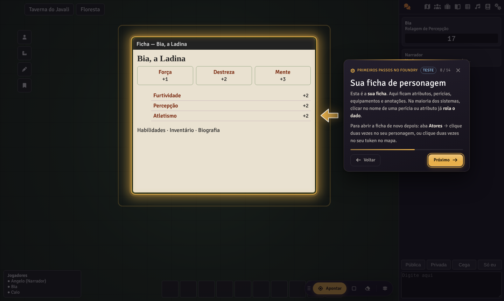
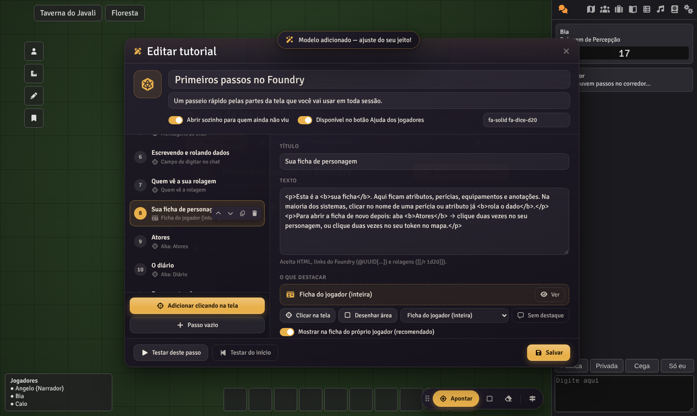
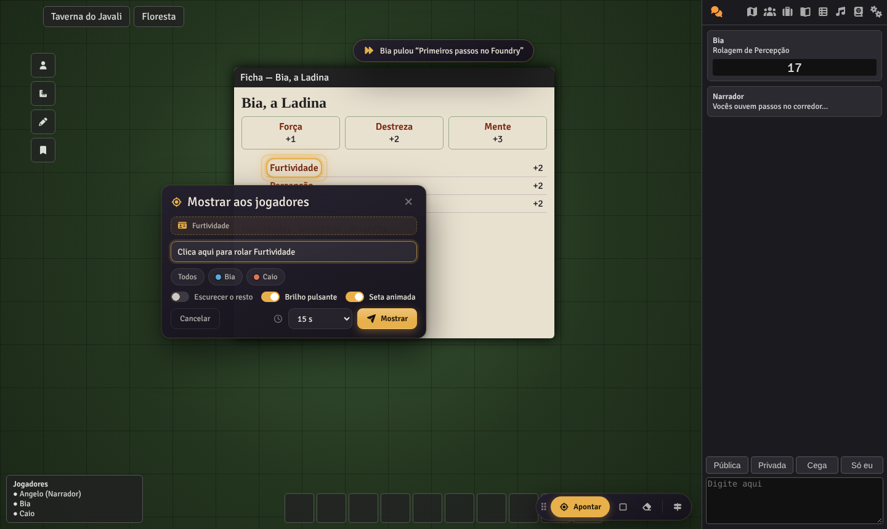
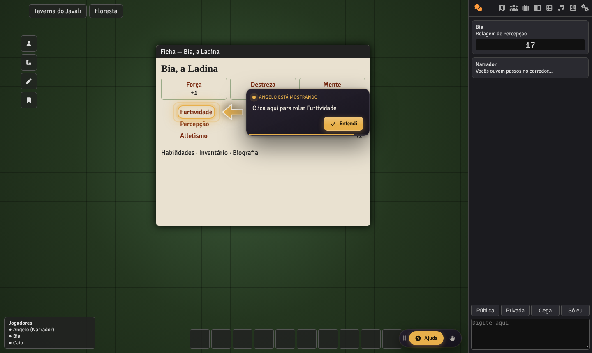

# Guia da Mesa — Tutoriais e Destaques para Foundry VTT

Módulo para ensinar quem **nunca usou o Foundry**. O narrador monta tutoriais clicando na própria tela. Durante a sessão, ele também pode **apontar ao vivo** qualquer botão, aba ou campo da ficha na tela dos jogadores, com holofote, brilho pulsante e seta animada.

Funciona com qualquer sistema de jogo. Compatível com Foundry **v12 e v13**.



## O que ele faz

### 1. Tutoriais montados pelo narrador
- **Modelo pronto “Primeiros passos no Foundry”** (14 passos, em português): mapa, barra lateral, chat, como rolar dados, quem vê a rolagem, ficha do personagem, atores, diário, ferramentas do mapa, barra de atalhos e jogadores. É só ajustar.
- **Adicionar clicando na tela**: clique em qualquer coisa, inclusive dentro de uma ficha, e o passo é criado.
- **Locais comuns** já mapeados (abas da barra lateral, chat, modo de rolagem, hotbar…), que funcionam no v12 e no v13.
- **Ficha do próprio jogador**: o narrador marca um campo na ficha de teste e cada jogador vê o mesmo campo **na ficha dele**.
- Para cada passo dá para escolher:
  - **o que destacar**: elemento, área desenhada ou nenhum (mensagem centralizada);
  - **efeitos**: escurecer o resto, brilho pulsante, seta animada;
  - **como avançar**: botão *Próximo* ou **o jogador clica no destaque** (aprende fazendo);
  - **ação antes do passo**: abrir aba, abrir a ficha do jogador, fechar janelas, abrir um diário, executar uma macro;
  - **posição do texto**, imagem opcional, e texto com HTML, `@UUID[...]` e `[[/r 1d20]]`.
- **Testar a partir de qualquer passo**, reordenar arrastando, duplicar e exportar/importar em JSON.
- **Abrir sozinho** para quem ainda não viu o tutorial, ou **enviar agora** para jogadores escolhidos.
- O narrador vê quem **concluiu ✔**, quem **pulou ⏩** e quem **ainda não viu**.



### 2. Apontar ao vivo durante o jogo
O jogador não acha onde fica algo? Clique em **Apontar** no painel flutuante (ou aperte **Alt+G**):
1. clique no elemento (a **rodinha do mouse** aumenta ou diminui a seleção; **Tab** troca para desenhar uma área);
2. se quiser, escreva uma mensagem e escolha para quem mostrar;
3. **Mostrar**.

O jogador vê o destaque com seta e brilho. Se a coisa estiver em uma aba fechada ou numa ficha que não está aberta, o módulo **abre sozinho**. Quando o jogador clica em *Entendi* ou no próprio destaque, o narrador recebe a confirmação.




### 3. Para os jogadores
Um botão flutuante **Ajuda** para refazer os tutoriais e um botão ✋ para **chamar o narrador**, que recebe um aviso na tela.

## Instalação
No Foundry: **Add-on Modules → Install Module → Manifest URL**:
```
https://raw.githubusercontent.com/angelomagnoBR/tutorial-foundry/main/module.json
```
> O pacote `guia-da-mesa.zip` fica na raiz do repositório. Ao mudar o código, gere o zip de novo e aumente o `version` no `module.json` para o Foundry oferecer a atualização.

## Configurações
- Cor dos destaques e escuridão do holofote (mundo)
- Botão de ajuda para jogadores (mundo)
- **Quem vê a barra flutuante**: em Configurações → Guia da Mesa → *Escolher usuários*, ligue ou desligue a barra para cada usuário (mestres e jogadores)
- Painel flutuante do narrador, eco do destaque na sua tela e som (por usuário)
- Atalhos em **Configurar Controles**: Apontar (Alt+G), Área (Alt+Shift+G), Apagar destaques, Abrir tutoriais

## API para macros
```js
const gdm = game.modules.get("guia-da-mesa").api;
gdm.openManager();                          // abre o gerenciador
gdm.startTour("Primeiros passos no Foundry"); // por nome ou id
gdm.point("element");                       // ou "area"
gdm.clear();
```
